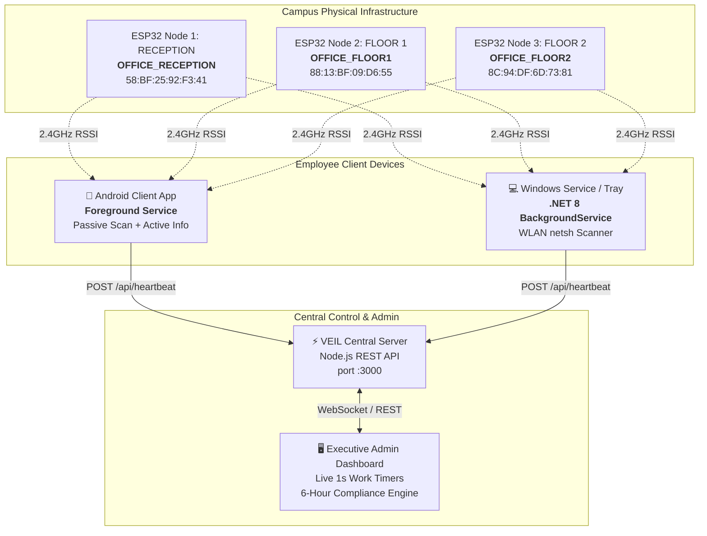

# VEIL — Virtual Electronic Indoor Localization & Campus Compliance System

<div align="center">


<br/>

**Enterprise-grade indoor geo-fencing, multi-floor attendance tracking, and 6-hour daily work hours compliance engine powered entirely by passive Wi-Fi RSSI signals — zero GPS required.**

</div>

---

## 📌 Executive Summary

Traditional GPS-based attendance systems fail inside corporate buildings due to signal attenuation, concrete multi-path drift, severe battery drain, and employee privacy concerns. 

**VEIL** replaces GPS entirely with **Passive Wi-Fi RSSI Signal Fusion**:
- **ESP32 Wi-Fi Beacons** broadcast designated campus SSIDs across floors.
- **Android Mobile App** and **Windows Background Service** passively scan floor beacon signal levels (RSSI in dBm) and active connection telemetry.
- **Real-Time Compliance Engine** monitors employee working hours against the mandatory **6-Hour Daily Rule**, aggregating daily, weekly, and monthly totals.
- **Executive Admin Dashboard** provides live workforce monitoring, floor-by-floor occupancy maps, compliance audits, and CSV reporting.

---

## 🏛️ System Architecture



---

## 🏢 Campus Floor Node Topology

The office campus is segmented into 3 physical zones powered by ESP32 microcontrollers configured as SoftAPs:

| Node | Zone / Floor | SSID | Default IP | Hardware MAC (BSSID) | Channel |
|---|---|---|---|---|---|
| **Node 1** | **RECEPTION** | `OFFICE_RECEPTION` | `192.168.4.1` | `58:BF:25:92:F3:41` | 1 |
| **Node 2** | **FLOOR 1** | `OFFICE_FLOOR1` | `192.168.4.1` | `88:13:BF:09:D6:55` | 1 |
| **Node 3** | **FLOOR 2** | `OFFICE_FLOOR2` | `192.168.4.1` | `8C:94:DF:6D:73:81` | 1 |

> Source code for flashing ESP32 chips is available in [`d:\VEIL\Esp\`](file:///d:/VEIL/Esp).

---

## ⏱️ 6-Hour Daily Working Hours & Compliance Engine

VEIL implements an automated compliance policy engine that continuously audits employee on-campus duration:

### 1. The 6-Hour Daily Rule
- **Threshold**: **6.0 Hours (21,600 seconds)** on campus per calendar day.
- **Live Accumulation**: Timers tick in real-time (`+1s/second`) whenever an employee device is detected inside any campus zone (`RECEPTION`, `FLOOR_1`, or `FLOOR_2`).
- **Pausing**: When an employee steps outside campus for lunch, errands, or off-site meetings, timers pause automatically.

### 2. Status Classification
| Status Badge | Criteria | Visual Indicator |
|---|---|---|
| **`✓ Compliant (6h+)`** | Today's accumulated hours ≥ 6.0 hrs | Glowing Emerald Green badge + 100% progress |
| **`⏳ In Progress`** | Today's hours < 6.0 hrs **AND** employee is currently **Inside Campus** | Amber badge + active pulse ticker |
| **`⚠ Non-Compliant (<6h)`** | Today's hours < 6.0 hrs **AND** employee is currently **Outside Campus** | Coral Red badge + warning flag |

### 3. Metric Aggregation
- **Today's Hours**: Formatted as `Xh Ym Zs` with real-time live tickers.
- **Weekly Total**: Aggregated against a 30.0-hour weekly standard.
- **Monthly Total**: Aggregated against a 132.0-hour monthly standard.

---

## 📊 Executive Admin Dashboard

The dashboard provides real-time oversight of the entire workforce and floor occupancy.

### Key Capabilities:
1. **Live Workforce KPIs**:
   - Real-time campus headcount (`X / Y enrolled` and percentage inside).
   - 6H Rule Compliant count and overall compliance percentage.
   - Non-compliant / pending headcount.
   - Average working hours today and weekly aggregate total.
2. **Three Interactive View Modes**:
   - **Grid View**: Visual cards displaying employee avatar, department, live floor zone, WiFi dBm signal, today's progress bar against 6 hours, and weekly/monthly totals.
   - **Data Table View**: Dense executive spreadsheet with sorting by today's hours, weekly hours, monthly hours, name, and compliance state.
   - **Floor Map View**: Live layout of Reception, Floor 1, Floor 2, and Outside showing active occupant chips.
3. **Employee Inspection Drawer**:
   - Detailed punch log timeline (e.g. check-in at Reception at 09:12 AM, moved to Floor 1 at 09:35 AM).
   - 6-Hour goal progress gauge with overtime tracking.
   - Hardware telemetry: connected AP, BSSID, RSSI (dBm), client platform (Android / Windows), battery %.
   - Interactive simulation controls (Simulate Check-out, Simulate Floor Hop).
4. **Export & Reporting**:
   - One-click **Export CSV** generating audit-ready attendance logs.
5. **Dark & Light Mode**:
   - Executive glassmorphic slate dark theme with toggleable high-contrast light mode.

---

## 🚀 Getting Started

### 1. Launching the Admin Dashboard

#### Option A: Run with Node.js Server (Recommended)
```powershell
cd d:\VEIL\dashboard
node server.js
```
Open **`http://localhost:3000`** in any web browser.

#### Option B: Standalone File (Zero Setup)
Simply double-click or open [`d:\VEIL\dashboard\index.html`](file:///d:/VEIL/dashboard/index.html) in your browser. All features, 1-second timers, simulation controls, and local persistence run out-of-the-box.

---

### 2. Android Mobile Client Setup

The Android app runs as a high-reliability Foreground Service.

#### Key Prerequisites:
- Android 7.0 (API 24) to Android 14 (API 34).
- **System Location Switch ON**: Android OS requires the master Location toggle in phone Quick Settings to be ON to allow Wi-Fi beacon scanning (`WifiManager.getScanResults()`). The app queries **no GPS coordinates**.
- If the phone is connected to office Wi-Fi, VEIL instantly uses the active connection telemetry as a zero-latency fallback.

#### Build & Install via ADB:
```powershell
cd d:\VEIL

# Build debug APK
.\gradlew.bat assembleDebug

# Install on connected device
& "$env:LOCALAPPDATA\Android\Sdk\platform-tools\adb.exe" install -r "app\build\outputs\apk\debug\app-debug.apk"

# Launch app
& "$env:LOCALAPPDATA\Android\Sdk\platform-tools\adb.exe" shell am start -n com.example.officegeotracker/.MainActivity
```

---

### 3. Windows Client Setup

The Windows client runs either as an interactive System Tray application or as a background service:

```powershell
cd d:\VEIL\VeilWindowsService

# Restore & Build
dotnet restore
dotnet build

# Run in Interactive System Tray Mode
dotnet run
```

To install as a headless Windows Service:
```powershell
dotnet publish -c Release -o ./publish
sc create VeilGeoFence binPath= "d:\VEIL\VeilWindowsService\publish\VeilGeoFenceService.exe --service"
sc start VeilGeoFence
```

---

## 📡 REST API Reference

The dashboard backend exposes standard REST endpoints for client integration:

| Method | Endpoint | Description |
|---|---|---|
| `GET` | `/api/employees` | Returns all enrolled employees, current zones, and work hours |
| `GET` | `/api/stats` | Returns aggregate workforce presence and compliance percentage |
| `POST` | `/api/heartbeat` | Receives client ping from Android or Windows and updates presence |

#### Example Heartbeat Payload:
```json
POST /api/heartbeat
Content-Type: application/json

{
  "employeeId": "EMP-101",
  "employeeName": "Swarnadeep Choudhury",
  "isInsideCampus": true,
  "currentZone": "FLOOR_1",
  "nearestAp": "OFFICE_FLOOR1",
  "bssid": "88:13:BF:09:D6:55",
  "signalDbm": -46,
  "device": "Android Mobile (Foreground Service)",
  "battery": 89
}
```

---

## 📁 Repository Directory Structure

```
d:\VEIL\
├── dashboard\                    # Executive Admin Dashboard & REST API
│   ├── index.html                # Semantic HTML5 UI structure
│   ├── style.css                 # Glassmorphic CSS design system
│   ├── app.js                    # Compliance engine & live timer logic
│   └── server.js                 # Pure Node.js HTTP & REST API server
│
├── app\                          # Android Client Application
│   ├── build.gradle              # Android build configuration (compileSdk 34)
│   └── src\main\
│       ├── AndroidManifest.xml   # Permissions (WiFi scan, Nearby devices)
│       ├── java\com\example\officegeotracker\
│       │   ├── GeoFenceConfig.java          # Campus AP nodes & thresholds
│       │   ├── GeoFenceChecker.java         # Pure WiFi RSSI localization
│       │   ├── GeoFenceTrackingService.java # Foreground scanning service
│       │   └── MainActivity.java            # Real-time Android UI
│       └── res\layout\
│           └── activity_main.xml            # Status card, node breakdown
│
├── VeilWindowsService\           # Windows Desktop Client
│   ├── Program.cs                # Entry point (tray or service mode)
│   ├── GeoFenceConfig.cs         # Windows configuration constants
│   ├── GeoFenceChecker.cs        # 100% WiFi RSSI decision logic
│   ├── GeoFenceTrackingService.cs# .NET 8 Background monitoring loop
│   ├── WifiScanner.cs            # netsh wlan scanner & dBm converter
│   └── TrayApplication.cs        # System tray UI with green/red status
│
├── Esp\                          # ESP32 Access Point Firmware
│   ├── Node 1 — RECEPTION.ino    # SoftAP: OFFICE_RECEPTION
│   ├── Node 2- Floor 1.ino       # SoftAP: OFFICE_FLOOR1
│   └── Node 3- Floor 2.ino       # SoftAP: OFFICE_FLOOR2
│
└── README.md                     # Comprehensive project documentation
```

---

## 🔒 Security & Privacy Commitments

- **No GPS Tracking**: Zero GPS coordinates are ever queried, logged, or transmitted.
- **Local Passive Scanning**: Telemetry is based strictly on local 2.4 GHz signal beacon strengths.
- **OS Compliance**: Adheres strictly to Android 14+ background execution limits and battery optimization guidelines.
